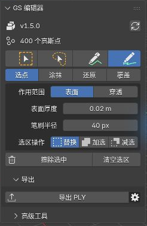

# GS Editor v1.5.0

Blender 4.2+ 的高斯泼溅（3DGS）工具：LTS 版提供**建模参考显示**，5.3+ 额外支持原生点云的**擦除、还原、覆盖**，中文界面。

拿来清扫描数据——擦掉灰尘毛发钉子，误删了局部找回来，要遮的地方糊一块贴合表面的面片。

`Blender 4.2+ / 原生编辑 5.3+` · `v1.5.0` · `GPL-3.0-or-later` · 基于 [Gaussian Splat Patch](https://github.com/timfennell/blender-splat-patch) 0.1.15

> Blender add-on for editing Gaussian splat point clouds: erase, restore, and cover with a rectangle that snaps to the surface.

## 安装

从 [v1.5.0 Release](https://github.com/Neocvsu-commits/Blender-GSEditor/releases/tag/v1.5.0) 按系统下载安装包：

- Windows：`gs_editor-1.5.0-windows.zip`
- macOS：`gs_editor-1.5.0-macos.zip`

两个安装包使用相同的纯 Python 源码。Blender 4.2+ 可用建模参考模式，原生高斯编辑仍要求 5.3+。Windows 4.2.22 已实测；4.5 LTS 与 macOS（目标为 Apple 芯片）尚未实测，不承诺相同显示性能。

参考对象的承载网格使用包围盒显示，避免在对象模式下叠加密集顶点；不需要关闭视口叠加层。启用插件、重开文件以及撤销/重做时会为已有参考对象应用该设置，高斯数据保持不变。

1. Blender → 编辑 → 偏好设置 → 获取扩展
2. 右上角下拉 → **从磁盘安装**，选这个 zip
3. 3D 视图按 N，侧栏底部「GS 编辑器」



## 功能与使用

### 选区（1.5.0）

2026-11-18：Windows Blender 5.3.0 Beta 的四种选择、两种深度筛选、原生选区联动、编辑模式擦除、旧配置迁移和最终界面绑定定向检查通过，最终界面已由使用者确认。此前的 4.2.22 参考选区存储与擦除检查通过；本次原生编辑与界面调整以 5.3 为主测试版本。未执行完整鼠标端到端回归，4.5 LTS 与 macOS 尚未实机验证。

选择性能：笔刷按触及的屏幕格缓存候选点，每个鼠标路径段仍精确计算，不降采样；原生选区最多每秒同步 20 次，松手立即提交完整结果。擦除仅读取需要修改的属性。Windows 5.3 的 300 万点模拟 CPU 对比中，12 段笔触平均计算从 86.55 ms 降到 3.31 ms，索引准备 25.33 ms；包含索引的合计耗时从 1038.56 ms 降到 65.02 ms。此数据不含投影准备、Blender 数据刷新和 GPU 显示，不代表视口帧率。选区结果一致性、松手提交、取消恢复和真实 PLY 擦除检查通过。

主面板顶部的一排图标依次为框选、套索、多边形、笔刷，重复的圆形刷选已移除。点击后激活左侧工具栏中的同名高斯选择工具，再到视口操作；每次手势完成即可点击「擦除选中」，旁边的「清空选区」保留点数据并取消选择。旧文件中的圆形刷选自动迁移为笔刷选点，其余选择方式保持不变。

笔刷有「选点 / 涂抹 / 还原 / 覆盖」四种功能，默认选点。动作按钮在上，参数分组居中，执行按钮在下；作用范围和替换/加选/减选各占一行。表面厚度与还原参数直接显示在面板内，不再使用齿轮弹窗。框选、套索、多边形只显示各自的选择设置；它们的「局部还原」入口会切到笔刷还原设置，调整后点「开始还原」。「导出」区保留 PLY 按钮，坐标轴及 GLB 选项收在导出齿轮中。「高级工具」只保留烘焙、合并、参考导入与快捷键。开始操作后，参数下方显示结束按钮。建模参考显示参数只在选中参考对象时出现。

Blender 5.3 原生点云点击图标会进入编辑模式，与 Blender 原生工具共用 `.selection`：原生选中的点可以直接擦除，插件选中的点可以继续原生加减选、全选、反选、移动和缩放。切换左侧框选、圆选、套索时，侧栏对应图标同步高亮。高斯工具加入左侧选择工具组，长按当前选择图标可切换。4.2+ 参考对象保留对象模式选区。选区随 blend 保存，选择手势和擦除均支持 Blender 撤销；参考对象擦除保留原始 PLY 属性，可用 Ctrl+Z 回退。

- 框选：拖动矩形，松开确认。
- 套索：按住左键描边，松开闭合确认。
- 多边形：逐点单击，回车闭合确认，退格撤回顶点。
- 笔刷：选点模式按住左键连续刷选，快速移动时自动连接笔触；涂抹、还原和覆盖模式先调整参数，再点对应的开始按钮。

高斯工具使用 Shift 临时加选、Ctrl 临时减选，Esc/右键取消当前手势；手势结束后可直接切换侧栏参数或左侧工具。多边形按回车确认。

高斯工具的表面模式按当前对象的高斯中心在 4 像素屏幕格中的最近深度近似判定，可调「表面厚度」；不等同于逐像素高斯透明度判断，也不检测其他网格的遮挡。穿透模式包含选区内所有深度。Blender 原生点云框选、圆选和套索当前按穿透方式工作，侧栏会如实显示「穿透」；点击「表面」会切到对应的高斯工具。高斯工具排除已隐藏点，显示点数上限不限制实际选择点数。参考对象橙色标记最多显示 20 万点，原生点云使用 Blender 自带的选区高亮。选择操作要求本地单用户数据。

### LTS 建模参考

在「GS 编辑器」主面板点击「导入高斯参考 PLY」（选中原生点云时，从「高级工具 → 导入建模参考 PLY」进入），导入标准 3DGS PLY（ASCII、二进制小端或大端），按源文件选择 Y/Z 朝上轴。导入的参考对象可以移动、旋转、缩放，通过大纲视图选择或隐藏；选中后按小键盘句点框选查看，在旁边使用原有工具建普通网格。

点坐标和 PLY 标量属性保存在网格数据块内，保存 `.blend` 后不再依赖原 PLY。重新打开时须启用本插件。视口绘制使用真实尺寸和朝向的投影高斯椭圆、透明排序与普通网格深度遮挡；深度采用高斯中心近似。默认最多显示 20 万点，可按机器性能提高上限，抽样不删除原数据。

兼容模式显示基础颜色，保留但暂不计算高阶视角颜色；只负责视口参考，不参加 F12 渲染。参考对象不是重建表面，不能直接用于面吸附、Shrinkwrap 或布尔；支持选区擦除，不开放原生笔刷还原、覆盖和 PLY 导出。暂不读取 SPZ、压缩 PLY，也不将旧的 5.3 原生点云自动转成参考对象，需先从原版本导出标准 PLY。

兼容目标：Blender 4.2 / 4.5 LTS，macOS Apple 芯片需实机验证；5.3+ 原有编辑路径保留。

### 原生编辑（Blender 5.3+）

| 工具 | 干什么 |
| --- | --- |
| **擦除** | 涂抹渐进删点，强度和羽化可调；「穿透」能清掉屏幕范围内所有深度 |
| **还原** | 涂抹局部回退，被擦掉的点、被淡化的点都能找回来 |
| **覆盖** | 拖一个矩形，面片吸附到表面、跟着鼠标走，左键确认 |

「笔刷 → 还原」恢复误擦区域；「笔刷 → 涂抹」提供原来的渐进擦除，「笔刷 → 覆盖」使用「开始覆盖」。**烘焙编辑**和**合并泼溅对象**保留在高级工具内，**导出 PLY**有独立入口。

## 覆盖怎么用

```
[开始覆盖] → 左键拖一个矩形 → 面片贴到框中心那片表面
   移动鼠标     跟着鼠标在表面上滑，朝向实时取局部表面法线
   Shift+移动   改成手动旋转
   滚轮         沿法线前后微调
   左键 / 回车   确认          右键 / Esc   取消
```

面片是刚性矩形，位置和旋转存在物体变换里，之后在 Object 面板还能调。尺寸默认「框多大就多大」，斜着看表面时屏幕投影会短一截，那是透视。

## 导出

PLY 只存每个点的坐标，没有场景变换节点，所以导出会把物体的位置、旋转和缩放直接烘焙进点坐标：视图里挪到哪，文件里就在哪。旋转会同时转到每个泼溅点自己的朝向和高阶（视角相关）颜色上；非等比缩放和镜像没法用单个泼溅点的旋转表示，会取等比近似，导出后给出提示。物体没动过时，导出和以前完全一致。

**坐标轴**：Blender 是 Z 轴朝上，glTF、three.js 和网页端泼溅查看器是 Y 轴朝上。导出面板的「坐标轴」默认 **Y 轴朝上（glTF / 网页）**，PLY 会做 `(x, y, z) → (x, z, −y)` 的换算，和同名的 GLB 落在同一个坐标系里——不这样转，网页里泼溅点会整体躺倒并相对其它模型偏出十几米，而同一个文件在 Blender 里看着完全正常。要再导回 Blender 编辑，选 **Z 轴朝上（Blender）**，绕一圈坐标才不变。

覆盖面片是网格，进不了 PLY。导出面板上勾着「同时导出覆盖面片 GLB」时，会把这些面片按世界坐标合并成一个网格，跟 PLY 同名另存 `.glb`（`模型_patched.ply` → `模型_patched.glb`），每块面片自己的颜色都保留；没有面片就不生成文件。GLB 用和 PLY 相同的坐标轴导出。

面片的判定只有一条：**当前选中的网格**就是覆盖面片（模型那个点云本身除外）；没选中就没有面片，不生成 GLB。导出后的提示会列出合并了哪些物体。

## 参数

选择时只显示当前形状需要的参数；笔刷的涂抹、还原和覆盖分别显示自己的参数。

| 笔刷 | 说明 |
| --- | --- |
| 画笔大小 · 边缘羽化 | 屏幕像素半径；羽化越宽，边缘删得越少 |
| 擦除强度 | 一笔删掉命中点的比例 |
| 选择深度 | 面板上并排两个按钮：表面 = 只动命中处，穿透 = 整个屏幕区域 |
| 笔触点间距 | 相邻笔触的距离，按半径比例 |

| 覆盖 | 说明 |
| --- | --- |
| 贴合表面 | 1 = 对齐表面，0 = 正对屏幕 |
| 面片偏移 | 沿法线往相机方向让开；有高斯点透出来就调大 |
| 尺寸按屏幕投影 | 关：框多大就多大；开：放大面片让投影盖满框 |
| 取周围颜色 · 取样环宽 | 取框外一圈的主流色；周围颜色杂时把环宽调小 |

## 自动更新

启动时在后台查一次 GitHub Releases，面板顶部显示版本和状态：

```
v1.5.0   ↻          ← 点 ↻ 手动重查
```

有新版时下面多一个红框：**一键更新** 直接下载 Release 里的扩展包覆盖安装，**更新说明** 打开 Release 页面。装完重启 Blender 生效。偏好设置 → 扩展 → GS Editor 里也有同一条更新栏和反馈入口。

不想联网的话，关掉 Blender 的「允许在线访问」（偏好设置 → 系统）就不会发任何请求。

## 快捷键

擦除 / 还原：`E` `R` 切工具（或 `1` `2`）· `F` 调大小 · `Shift+F` 调羽化 · `[` `]` 缩放笔刷 · `X` 切表面/穿透 · `Esc` 结束

覆盖：移动吸附 · `Shift`+移动手动旋转 · 左键确认 · 右键取消 · 滚轮前后 · `Esc` 结束

## 已知限制

- LTS 参考模式已在 Windows 4.2.22 上用约 26 万点的真实 PLY 确认显示，包含开启叠加层的情况；插件注册、已有对象显示迁移和注销检查通过。三种 PLY 编码读取与 `.blend` 数据保存恢复已做定向检查。
- 早期离屏绘制检查得到空图像，实际视口显示已验证，离屏检查原因未定位；开发期间热重载后切换编辑器曾触发 Blender 崩溃，原因未确认。升级插件后请保存工程并重启 Blender，不在工作场景中热重载。
- 覆盖生成的是网格，**不写入 PLY**：勾选「同时导出覆盖面片 GLB」会另存同名 `.glb`，或者交付 `.blend`。
- 面片是平的，很难贴住强弯曲表面；弧面拆成几块，或把「面片偏移」调大。
- 视线与表面夹角小于约 3° 时会提示换角度。
- 百万级点云首次进入覆盖，有一两秒读取延迟。

## 开发

`scripts/verify.py` 是 Blender 内自检，121 项，覆盖几何、界面、擦除/还原的真实代码路径、导出和更新安装流程。构建扩展包：

```bash
blender --factory-startup --command extension build --source-dir gs_editor --output-dir release
```

## 许可

GPL-3.0-or-later，见 [LICENSE](LICENSE) 与 [NOTICE.md](NOTICE.md)。

衍生自 Tim Fennell 的 Gaussian Splat Patch 0.1.15：点云读写、擦除/还原/烘焙/合并/导出来自上游，界面与「覆盖」是本项目新增。点云内部属性沿用上游 `gsp_` 前缀，`.blend` 在两个版本间打开时擦除记录不丢。
