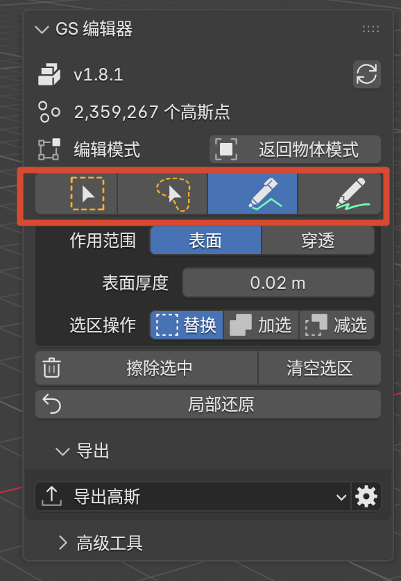

# GS Editor v1.8.3

v1.8.3 优化大点云选择：同一视角下复用屏幕投影、表面筛选和空间索引，减少重复起笔与工具切换的等待；长套索和多边形只对跨越各边高度范围的点计算交点。保持全部点与完整轮廓，选区仍与 Blender 原生选择共用；视角、模型位置或可见性变化会使缓存失效，撤销和加载文件时清理缓存。

2026-11-28 单次定向基准：2359267 点、1920×1080 视口，同视角索引准备从 304.45 ms 降到 11.10 ms，128 顶点套索从 150.70 ms 降到 66.59 ms；144 组边界对照及缓存失效检查通过。首次索引仍需约 290 ms。这是后台计算耗时，不代表完整视口帧率，未进行 macOS 实机验证。

v1.8.2 修复插件启用时场景迁移触发 Blender 数据访问限制、导致选择工具注册中断的问题。场景迁移延后执行，使编辑模式中的框选、套索、多边形、笔刷及「表面 / 穿透」作用范围可以正常切换。

v1.8.1 在主面板点数下显示 Blender 当前模式：编辑模式下可点「返回物体模式」，物体模式下可点「编辑高斯」。模式入口独立于选择工具的禁用状态。高斯工具在编辑模式下支持普通 Tab 返回物体模式，先结束当前手势或笔刷并释放资源；未确认的多边形手势取消，已完成的编辑保留。

v1.8.0 按新的工作流程移除覆盖面片功能：删除覆盖按钮、参数、快捷键与附带的 GLB 导出。笔刷保留「选点 / 涂抹 / 还原」。旧文件的覆盖状态自动回退到选点；已生成的面片作为普通网格保留，不会被删除。

2026-11-27 定向检查：Windows Blender 5.3 注册/注销、三个笔刷界面的绘制路径、旧覆盖枚举迁移、还原枚举保留，以及 PLY 和后台 SPZ 导出通过；旧面片网格保持原样，不再生成附带 GLB。未执行完整鼠标交互或 macOS 实机验证。

v1.7.1 修复 LCC / LCC2 导出忽略坐标轴设置的问题。保存窗口可直接选择「Y 轴朝上（网页兼容 / glTF）」或「Z 轴朝上（LCC 标准 / Blender）」，沿用场景中的已有选择。此前导出的文件需要重新导出才会应用新轴向。

2026-11-27 轴向定向检查：独立 Windows Blender 5.3 进程执行 LCC / LCC2 的真实导出操作，两种轴向下包含物体变换的位置、四元数和球谐方向颜色均符合预期，原对象数据与变换保持不变。用户目标网页的最终朝向待重新上传确认。

「导出高斯」菜单支持 PLY / SOG / SPZ / Splat / LCC / LCC2，均已包含在 [v1.8.3 Release](https://github.com/Neocvsu-commits/Blender-GSEditor/releases/tag/v1.8.3) 中。

| 格式 | 用途与取舍 |
| --- | --- |
| PLY | 标准 3DGS，保留完整浮点属性与高阶球谐；适合继续编辑 |
| SOG | SOG v2，真实无损 WebP 纹理组成的压缩包；位置与属性量化，高阶球谐使用最多 65536 项调色盘 |
| SPZ | SPZ v2/gzip，有损量化，保留 0–3 阶球谐；位置范围约 ±2048 场景单位，超出会报错 |
| Splat | 传统 32 字节/点格式；仅基础颜色，无法保留高阶球谐 |
| LCC + LOD | 旧版 LCC 5.0，空间网格 + 各块多级 LOD；ZIP 包含 `meta.lcc`、索引、数据及可选 SH 文件 |
| LCC2 + LOD | LCC2 0.0.3，空间节点树 + 独立 SOG 数据块；ZIP 包含 `meta.lcc2` 与全部 `blocks/*.sog` |

### 网页 LOD 交付

选择 LCC 或 LCC2 后保存 ZIP，上传整包；自行部署时解压并保留目录结构，让网页加载 `meta.lcc` / `meta.lcc2`。不需要单独寻找和打包数据文件。ZIP 超过 500 MB 会在导出完成时提示，以便对照网站上传限制。

默认生成 4 级 LOD：精细层保留所有未擦除的点，后续层每次将约 4 个相邻高斯合并，点数约为 100% / 25% / 6.25% / 1.56%。小块尾数向上取整；单点块各层相同。合并使用空间邻近顺序、带位置分布的协方差、透明度/面积加权颜色和球谐，粗层属于近似，可能损失细节或产生模糊；并非其域的采集或重训练算法，不承诺相同画质。精细层也存在所选存储格式自身的量化误差。

默认每块目标为 65,536 点，可调整层数与分块目标；XY 网格分块会受密度、竖直分布及分块数量预算影响，目标不是硬性上限。高阶球谐在 LCC 中以 SH3 表示（SH1/2 补零），LCC2 的 SOG 块保留源阶数。导出过程在后台生成，不改变场景点云或选区。

**必须由网页读取 LOD 并调度分块，才会降低远景绘制量和按需加载量。** 仅支持上传 LCC、或导入后转换成单层点云，不代表网页会使用 LOD。尚未验证用户目标网站的加载、画质或帧率，也未做 macOS 实机验证。LCC2 需查看器版本支持；不通过修改扩展名伪装旧格式。

LCC 标准使用 **Z-up 坐标**。v1.7.1 起两种 LCC 都遵从导出窗口的轴向设置：标准 LCC 查看器选 Z 朝上；直接按 Y 朝上显示、且未转换 LCC 坐标的网页可选 Y 朝上兼容模式。Y-up 会把整个数据旋转后再生成空间分块、包围框及所有 LOD；位置、高斯旋转和高阶球谐一起转换，原场景保持不变。查看器如果也转轴，可能发生重复转换。Y-up 兼容模式仍按格式 XY 网格划分，可能降低地面大场景的分块效率；它不是标准 Z-up 朝向。每个 ZIP 内的 USER_GUIDE.txt 记录实际导出轴向。

2026-11-27 定向验证：Windows Blender 5.3.0 Beta 注册与两种 ZIP 导出通过；8,195 个合成高斯分为 4 块，四级点数为 8,195 / 2,050 / 513 / 131。精细层输入记录完整保留；单点、竖直点列与失败不覆盖目标的检查通过。PlayCanvas splat-transform 3.12.0 独立读取器逐级解码两种产物，位置、尺度、旋转、颜色、透明度与 45 个高阶 SH 系数均在预设量化误差内。此检查不包含网页帧率、远景画质或 macOS 实机测试。

Data Organization Format originated from XGRIDS

格式与使用条件：[LCC 白皮书](https://github.com/xgrids/LCCWhitepaper)、[LCC2 白皮书](https://github.com/xgrids/LCC2Whitepaper)。导出界面显示归属，交付包保留 `FORMAT_NOTICE.txt` 和说明链接；独立实现，不代表 XGRIDS 官方工具或认证。源码许可与格式的许可条件分别见 [NOTICE.md](NOTICE.md)。

从 N 面板「导出 → 导出高斯」选择格式，在保存窗口确认位置。新格式先冻结当前点云，再在独立后台进程压缩；可在面板点取消或按 Esc。转换失败或取消不覆盖已有目标文件。创建 PLY 快照期间仍需等待 Blender 完成数据读取。

2026-11-27 定向验证：Windows Blender 5.3.0 Beta 完成注册、后台转换、失败保护及原生 SPZ 导入；65,538 点（包含物体变换、隐藏点排除及三阶球谐）的四格式产物通过 PlayCanvas splat-transform 3.12.0 官方读取器完整解码。位置、尺寸与高阶球谐在格式量化误差内一致；SOG 验证覆盖超过 65,536 点的调色盘分组路径。未做完整鼠标交互回归或 macOS 实机验证。

PLY、SOG、SPZ、Splat 沿用当前物体变换、Y/Z 朝上轴、排除已擦除点。标准 SPZ 查看器通常按 Y-up 解释坐标；SOG/PLY 查看器可能应用自己的训练坐标系转换，接入引擎时应统一其坐标约定。

SOG 内置 Google WebP 1.6.0 编码器（Windows x64 / macOS Apple Silicon），无需联网或另装依赖。格式依据：[PlayCanvas SOG v2](https://developer.playcanvas.com/user-manual/gaussian-splatting/formats/sog-v2/)、[Niantic SPZ](https://github.com/nianticlabs/spz/tree/v1.1.0)、[antimatter15 Splat](https://github.com/antimatter15/splat/blob/main/convert.py)。当前导出入口用于 Blender 5.3 原生高斯点云，LTS 建模参考模式范围不变；macOS 尚待实机验证。

Blender 4.2+ 的高斯泼溅（3DGS）工具：LTS 版提供**建模参考显示**，5.3+ 额外支持原生点云的**选择、擦除、还原**，中文界面。

用于清理扫描数据：选择并擦除多余高斯点，或通过还原笔刷找回误删的区域。

`Blender 4.2+ / 原生编辑 5.3+` · `v1.8.3` · `GPL-3.0-or-later` · 基于 [Gaussian Splat Patch](https://github.com/timfennell/blender-splat-patch) 0.1.15

> Blender add-on for editing Gaussian splat point clouds: select, erase, restore, and export in multiple formats.

## 安装

从 [v1.8.3 Release](https://github.com/Neocvsu-commits/Blender-GSEditor/releases/tag/v1.8.3) 按操作系统下载安装包：

- Windows：[gs_editor-1.8.3-windows.zip](https://github.com/Neocvsu-commits/Blender-GSEditor/releases/download/v1.8.3/gs_editor-1.8.3-windows.zip)
- macOS：[gs_editor-1.8.3-macos.zip](https://github.com/Neocvsu-commits/Blender-GSEditor/releases/download/v1.8.3/gs_editor-1.8.3-macos.zip)

两个安装包包含相同的跨平台源码与 Windows x64 / Apple Silicon WebP 编码器，文件名后缀便于按平台分发。Blender 4.2+ 可用建模参考模式，原生高斯编辑及多格式导出要求 5.3+。Windows 4.2.22 与 5.3 Beta 已做对应功能检查；4.5 LTS 与 macOS（目标为 Apple 芯片）尚未实测，不承诺相同显示性能。

参考对象的承载网格使用包围盒显示，避免在对象模式下叠加密集顶点；不需要关闭视口叠加层。启用插件、重开文件以及撤销/重做时会为已有参考对象应用该设置，高斯数据保持不变。

1. Blender → 编辑 → 偏好设置 → 获取扩展
2. 右上角下拉 → **从磁盘安装**，选这个 zip
3. 3D 视图按 N，侧栏底部「GS 编辑器」



## 功能与使用

### 选区（1.5.0）

2026-11-18：Windows Blender 5.3.0 Beta 的四种选择、两种深度筛选、原生选区联动、编辑模式擦除、旧配置迁移和最终界面绑定定向检查通过，最终界面已由使用者确认。此前的 4.2.22 参考选区存储与擦除检查通过；本次原生编辑与界面调整以 5.3 为主测试版本。未执行完整鼠标端到端回归，4.5 LTS 与 macOS 尚未实机验证。

选择性能：笔刷按触及的屏幕格缓存候选点，每个鼠标路径段仍精确计算，不降采样；原生选区最多每秒同步 20 次，松手立即提交完整结果。擦除仅读取需要修改的属性。Windows 5.3 的 300 万点模拟 CPU 对比中，12 段笔触平均计算从 86.55 ms 降到 3.31 ms，索引准备 25.33 ms；包含索引的合计耗时从 1038.56 ms 降到 65.02 ms。此数据不含投影准备、Blender 数据刷新和 GPU 显示，不代表视口帧率。选区结果一致性、松手提交、取消恢复和真实 PLY 擦除检查通过。

主面板顶部的一排图标依次为框选、套索、多边形、笔刷，重复的圆形刷选已移除。点击后激活左侧工具栏中的同名高斯选择工具，再到视口操作；每次手势完成即可点击「擦除选中」，旁边的「清空选区」保留点数据并取消选择。旧文件中的圆形刷选自动迁移为笔刷选点，其余选择方式保持不变。

笔刷有「选点 / 涂抹 / 还原」三种功能，默认选点。动作按钮在上，参数分组居中，执行按钮在下；作用范围和替换/加选/减选各占一行。表面厚度与还原参数直接显示在面板内，不再使用齿轮弹窗。框选、套索、多边形只显示各自的选择设置；它们的「局部还原」入口会切到笔刷还原设置，调整后点「开始还原」。「导出」区提供六种高斯格式，坐标轴可在导出齿轮或保存窗口中选择。「高级工具」只保留烘焙、合并、参考导入与快捷键。开始操作后，参数下方显示结束按钮。建模参考显示参数只在选中参考对象时出现。

Blender 5.3 原生点云点击图标会进入编辑模式，与 Blender 原生工具共用 `.selection`：原生选中的点可以直接擦除，插件选中的点可以继续原生加减选、全选、反选、移动和缩放。切换左侧框选、圆选、套索时，侧栏对应图标同步高亮。高斯工具加入左侧选择工具组，长按当前选择图标可切换。4.2+ 参考对象保留对象模式选区。选区随 blend 保存，选择手势和擦除均支持 Blender 撤销；参考对象擦除保留原始 PLY 属性，可用 Ctrl+Z 回退。

- 框选：拖动矩形，松开确认。
- 套索：按住左键描边，松开闭合确认。
- 多边形：逐点单击，回车闭合确认，退格撤回顶点。
- 笔刷：选点模式按住左键连续刷选，快速移动时自动连接笔触；涂抹和还原模式先调整参数，再点对应的开始按钮。

高斯工具使用 Shift 临时加选、Ctrl 临时减选，Esc/右键取消当前手势；手势结束后可直接切换侧栏参数或左侧工具。多边形按回车确认。

高斯工具的表面模式按当前对象的高斯中心在 4 像素屏幕格中的最近深度近似判定，可调「表面厚度」；不等同于逐像素高斯透明度判断，也不检测其他网格的遮挡。穿透模式包含选区内所有深度。Blender 原生点云框选、圆选和套索当前按穿透方式工作，侧栏会如实显示「穿透」；点击「表面」会切到对应的高斯工具。高斯工具排除已隐藏点，显示点数上限不限制实际选择点数。参考对象橙色标记最多显示 20 万点，原生点云使用 Blender 自带的选区高亮。选择操作要求本地单用户数据。

### LTS 建模参考

在「GS 编辑器」主面板点击「导入高斯参考 PLY」（选中原生点云时，从「高级工具 → 导入建模参考 PLY」进入），导入标准 3DGS PLY（ASCII、二进制小端或大端），按源文件选择 Y/Z 朝上轴。导入的参考对象可以移动、旋转、缩放，通过大纲视图选择或隐藏；选中后按小键盘句点框选查看，在旁边使用原有工具建普通网格。

点坐标和 PLY 标量属性保存在网格数据块内，保存 `.blend` 后不再依赖原 PLY。重新打开时须启用本插件。视口绘制使用真实尺寸和朝向的投影高斯椭圆、透明排序与普通网格深度遮挡；深度采用高斯中心近似。默认最多显示 20 万点，可按机器性能提高上限，抽样不删除原数据。

兼容模式显示基础颜色，保留但暂不计算高阶视角颜色；只负责视口参考，不参加 F12 渲染。参考对象不是重建表面，不能直接用于面吸附、Shrinkwrap 或布尔；支持选区擦除，不开放原生笔刷还原和 PLY 导出。暂不读取 SPZ、压缩 PLY，也不将旧的 5.3 原生点云自动转成参考对象，需先从原版本导出标准 PLY。

兼容目标：Blender 4.2 / 4.5 LTS，macOS Apple 芯片需实机验证；5.3+ 原有编辑路径保留。

### 原生编辑（Blender 5.3+）

| 工具 | 干什么 |
| --- | --- |
| **擦除** | 涂抹渐进删点，强度和羽化可调；「穿透」能清掉屏幕范围内所有深度 |
| **还原** | 涂抹局部回退，被擦掉的点、被淡化的点都能找回来 |

「笔刷 → 还原」恢复误擦区域；「笔刷 → 涂抹」提供原来的渐进擦除。**烘焙编辑**和**合并泼溅对象**保留在高级工具内，**导出 PLY**有独立入口。


## 导出

PLY 只存每个点的坐标，没有场景变换节点，所以导出会把物体的位置、旋转和缩放直接烘焙进点坐标：视图里挪到哪，文件里就在哪。旋转会同时转到每个泼溅点自己的朝向和高阶（视角相关）颜色上；非等比缩放和镜像没法用单个泼溅点的旋转表示，会取等比近似，导出后给出提示。物体没动过时，导出和以前完全一致。

**坐标轴**：所有导出格式遵从保存窗口的 Y/Z 选择。Blender 世界与标准 LCC 使用 Z-up；直接按 Y 朝上显示的网页可选 Y-up 兼容模式。转换同时应用于位置、旋转和高阶球谐，原场景保持不变。

## 参数

选择时只显示当前形状需要的参数；笔刷的选点、涂抹和还原分别显示自己的参数。

| 笔刷 | 说明 |
| --- | --- |
| 画笔大小 · 边缘羽化 | 屏幕像素半径；羽化越宽，边缘删得越少 |
| 擦除强度 | 一笔删掉命中点的比例 |
| 选择深度 | 面板上并排两个按钮：表面 = 只动命中处，穿透 = 整个屏幕区域 |
| 笔触点间距 | 相邻笔触的距离，按半径比例 |


## 自动更新

启动时在后台查一次 GitHub Releases，面板顶部显示版本和状态：

```
v1.8.3   ↻          ← 点 ↻ 手动重查
```

有新版时下面多一个红框：**一键更新** 直接下载 Release 里的扩展包覆盖安装，**更新说明** 打开 Release 页面。装完重启 Blender 生效。偏好设置 → 扩展 → GS Editor 里也有同一条更新栏和反馈入口。

不想联网的话，关掉 Blender 的「允许在线访问」（偏好设置 → 系统）就不会发任何请求。

## 快捷键

擦除 / 还原：`E` `R` 切工具（或 `1` `2`）· `F` 调大小 · `Shift+F` 调羽化 · `[` `]` 缩放笔刷 · `X` 切表面/穿透 · `Esc` 结束


## 已知限制

- LTS 参考模式已在 Windows 4.2.22 上用约 26 万点的真实 PLY 确认显示，包含开启叠加层的情况；插件注册、已有对象显示迁移和注销检查通过。三种 PLY 编码读取与 `.blend` 数据保存恢复已做定向检查。
- 早期离屏绘制检查得到空图像，实际视口显示已验证，离屏检查原因未定位；开发期间热重载后切换编辑器曾触发 Blender 崩溃，原因未确认。升级插件后请保存工程并重启 Blender，不在工作场景中热重载。

## 开发

`scripts/verify.py` 保留 Blender 内历史自检；覆盖面片与 GLB 专属检查随功能移除。当前改动按范围做定向验证。构建扩展包：

```bash
blender --factory-startup --command extension build --source-dir gs_editor --output-dir release
```

## 许可

GPL-3.0-or-later，见 [LICENSE](LICENSE) 与 [NOTICE.md](NOTICE.md)。

衍生自 Tim Fennell 的 Gaussian Splat Patch 0.1.15：点云读写、擦除/还原/烘焙/合并/导出来自上游，中文界面、选择联动和多格式导出是本项目新增。点云内部属性沿用上游 `gsp_` 前缀，`.blend` 在两个版本间打开时擦除记录不丢。
